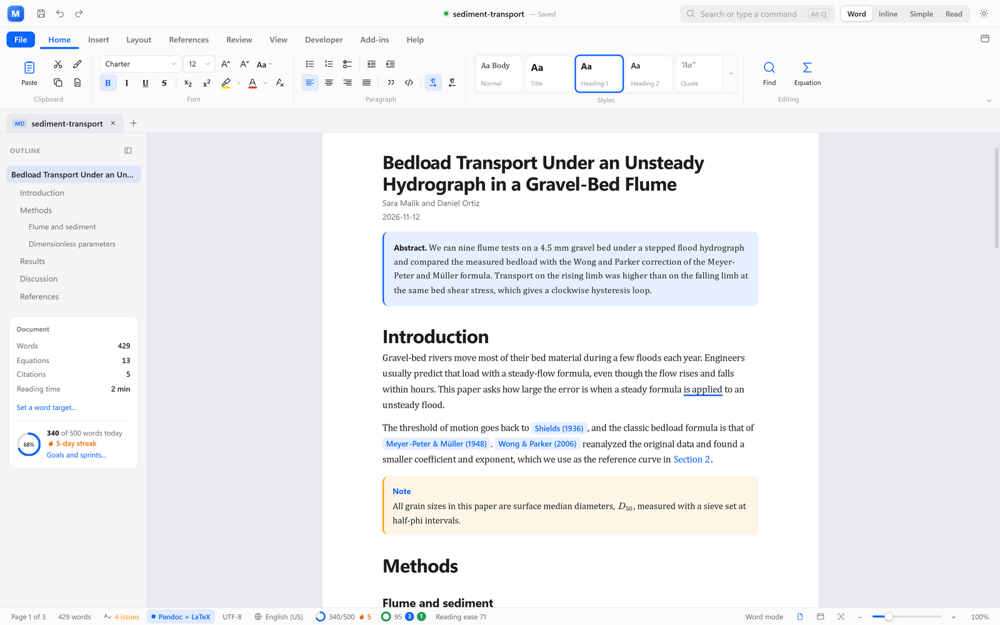
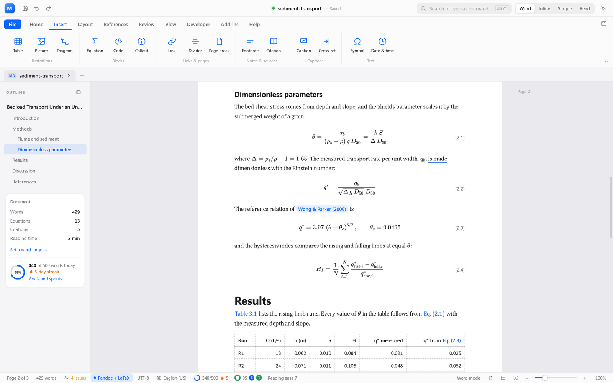
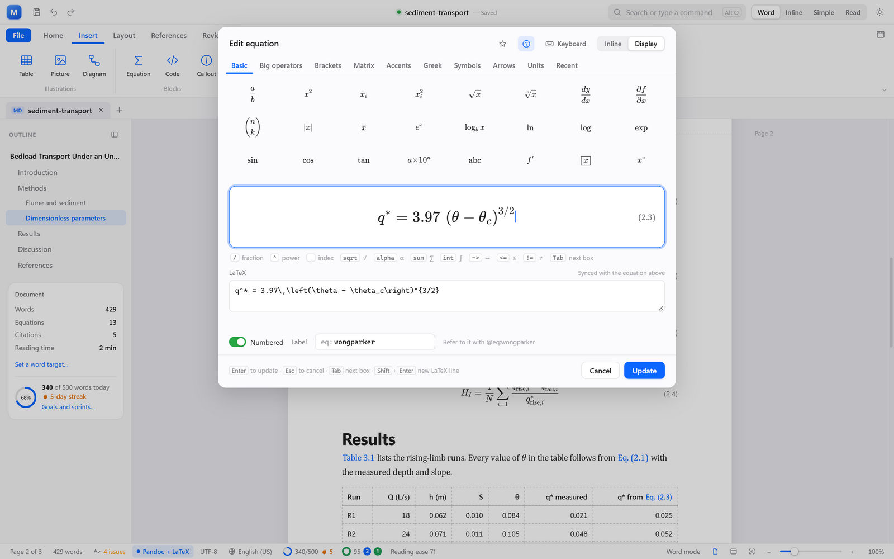
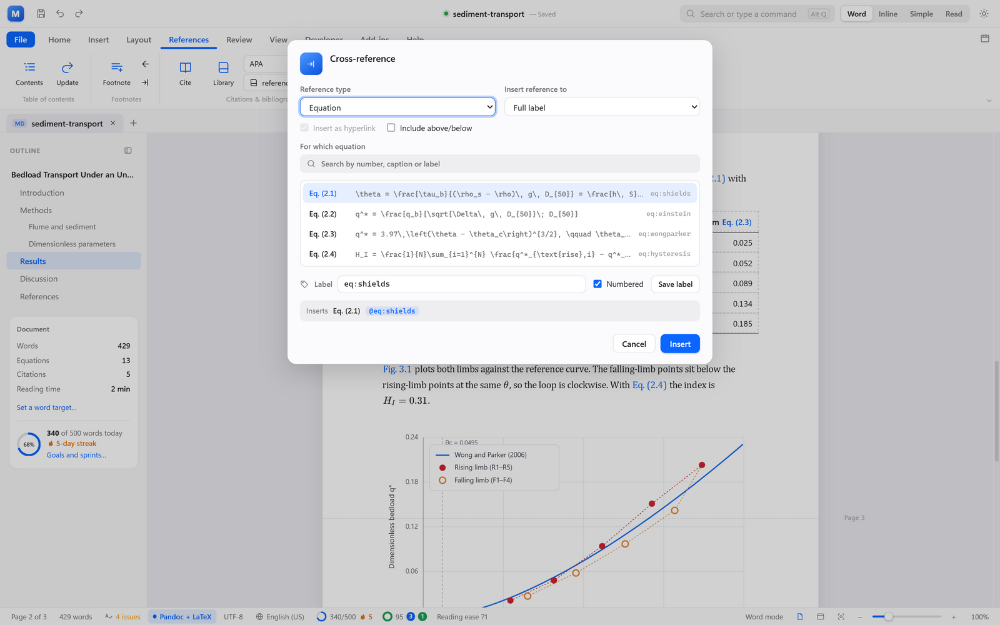
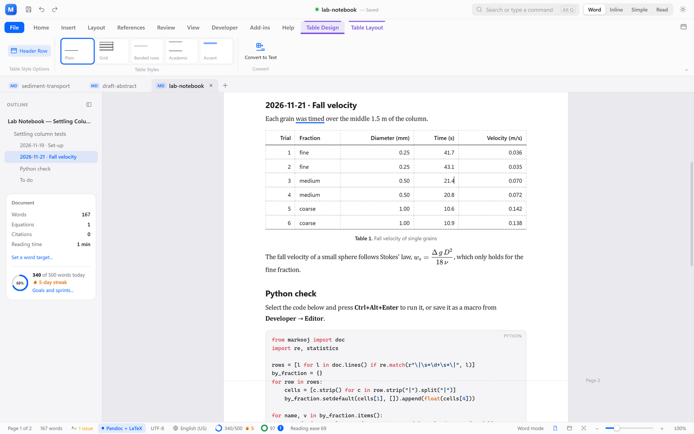
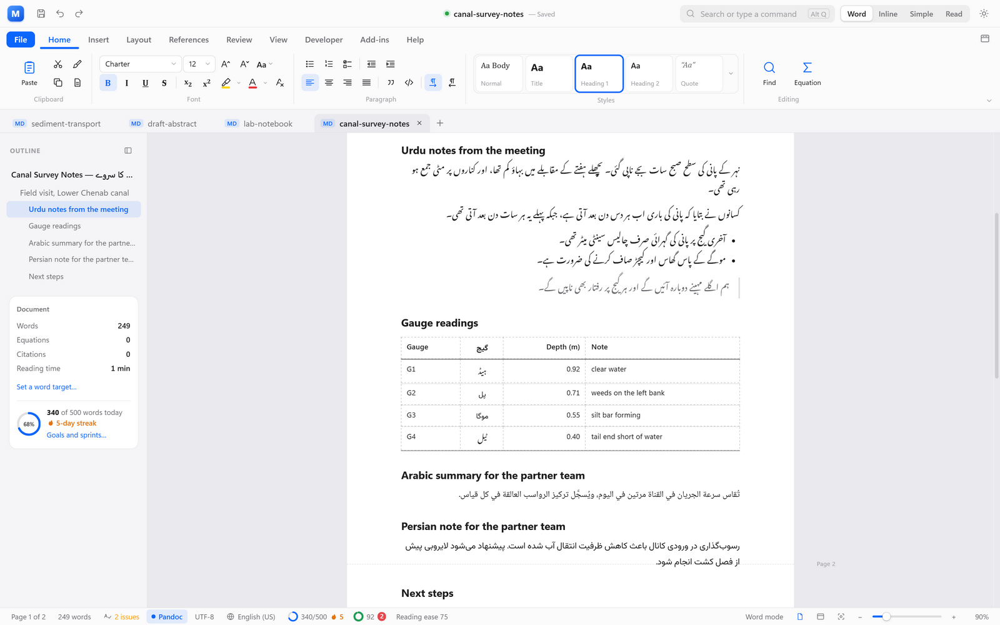
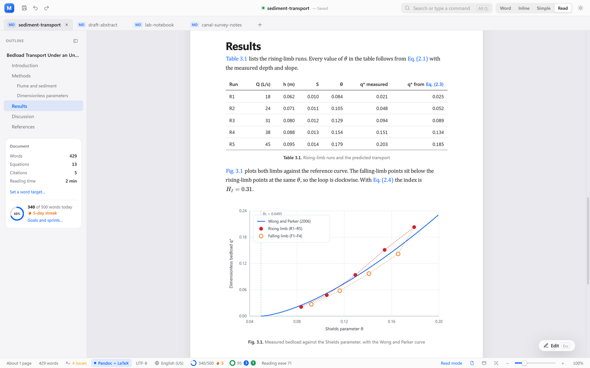
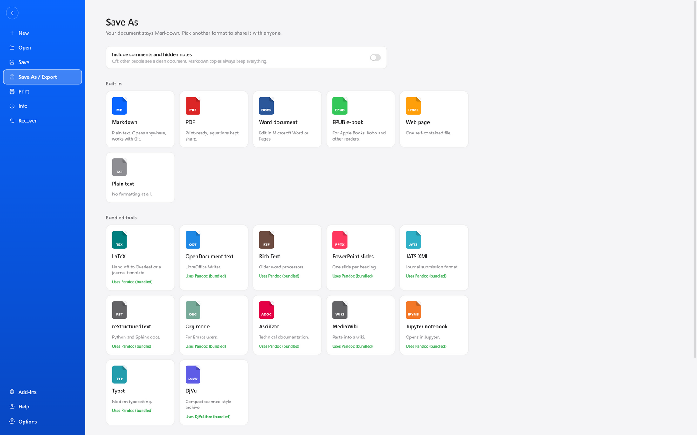
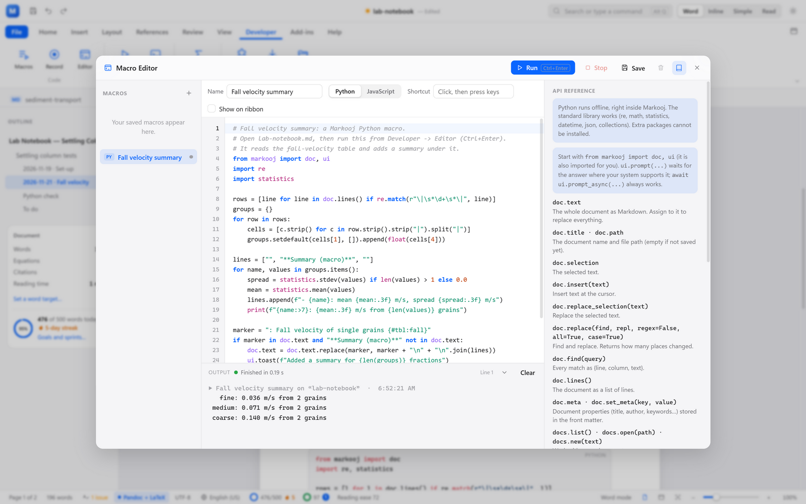
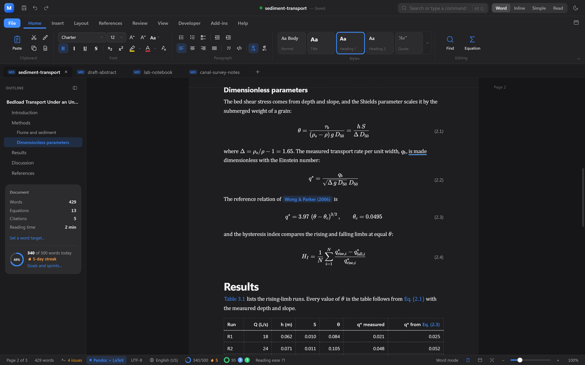

# Markooj


A calm Markdown editor that works like Microsoft Word, made with researchers in mind.

Markooj is free and open-source software for Windows, macOS and Linux. You click and type on a page, with the ribbon and the keyboard shortcuts you already know, and Markooj writes plain Markdown for you. Everything happens on your own computer, and it works without an internet connection.

**[Download the latest version](https://github.com/datakeen/markooj/releases/latest)** · **[Website](https://datakeen.github.io/markooj/)** · [Help and tutorials](docs/help/index.md) · [What's new](CHANGELOG.md)



## What it is, and who it is for

Markdown is plain text with a few marks in it, such as `**bold**` and `# Heading`. Files written in it open anywhere, last for decades, work with Git, and go straight into Pandoc, Quarto, Overleaf and many journal workflows. But most people learned to write in Word, and a blank text file with marks in it can feel like a step back.

Markooj is for them:

- **People who know Word** and want plain, future-proof files without learning a new way of working. The Home, Insert, Layout, References, Review and View tabs are where you expect them, and Ctrl+B, F7, F12 and Shift+F3 do what you expect.
- **Researchers and students** who write papers and theses with equations, numbered figures and tables, cross-references, citations from Zotero or another reference manager, and footnotes, and who need to hand in a Word file or a PDF at the end.
- **Writers in Urdu, Arabic, Persian and Punjabi (Shahmukhi)**, who need right-to-left text that just works, next to English.
- **People who like Markdown** too: Inline and Simple modes show the marks, and nothing is ever hidden from you.

## What it does

### Write the way you already do

- **Four editing modes, one file.** **Word** mode: click and type on the page. **Inline** mode: the page looks finished, and the paragraph you are in shows its Markdown. **Simple** mode: Markdown on the left, a live preview on the right. **Read** mode: the finished document. Switch with Ctrl+1 to Ctrl+4; your place stays put.
- **A ribbon like Word's**, with ScreenTips on every button, a dimmed button that says why it is dimmed, Table Design and Table Layout tabs that appear in a table, and **KeyTips**: press Alt and type the letters. Pin the ribbon, show tabs only, or go full screen.
- **Word's keyboard shortcuts** wherever Markdown has the same thing: almost a hundred of them, listed in Options and in the manual.
- **Word habits that just work:** undo one step at a time, Format Painter, Styles, Find and Replace, Change Case (with APA and Chicago Title Case), Grow and Shrink Font, AutoCorrect, smart quotes, paste from Word with its formatting, drag-and-drop pictures.
- **"What's this in Markdown?"** (Ctrl+Shift+/) shows the Markdown behind any selection, so you learn as you go.
- **Tabs for many documents**, at the top, the bottom or the left, an outline of your headings, zoom, focus mode, typewriter scrolling, and light and dark themes.



### Equations

- **A visual equation editor** that also speaks LaTeX, both kept in step: palettes for fractions, roots, big operators, brackets, matrices with a size picker, accents, Greek letters, arrows and units; typing shortcuts such as `/` for a fraction and `alpha` for α; an on-screen math keyboard; recent and favorite equations.
- **Inline and display math**, with a Numbered switch and a label.
- **Math macros:** define `\R` once for ℝ and use it everywhere. Paste `\newcommand` lines straight from a LaTeX preamble; a gallery of examples shows what each one does.



### Numbers, references and citations

- **One numbering system** for equations, figures, tables and sections, in the Pandoc-crossref syntax that Pandoc and Quarto read. Numbers like (1) or chapter style (2.3), in a margin of their own so they never overlap a long equation.
- **Insert Caption** and a **Cross-reference** dialog laid out like Word's. References update themselves when things move; rest the pointer on one for a preview, Ctrl+click to jump.
- **Citations from a BibTeX library** (Zotero, Mendeley, JabRef, EndNote) in APA, Chicago or IEEE, with page numbers, a bibliography that fills itself, footnotes and a table of contents.



### A Writing Assistant that explains itself

- **Spelling** in US and UK English, **grammar** (Harper), and checks for **clarity** (long sentences, wordy phrases, passive voice, hidden verbs, undefined abbreviations), **engagement** (overused words, repeated sentence starts) and **delivery** (contractions, hedging, informal words).
- **Wrong prepositions**, the slips that are easy to make when you write in your second language: *discuss about*, *comprise of*, *different than*, *married with* and many more.
- **Every card says why**, with a wrong and a right example. Accept, dismiss, ignore the rule, or add the word to your dictionary. A writing score, goals for audience, formality and domain (academic, general or business), and an F7 dialog like Word's Editor.
- **Synonyms** on a double-click and a **Thesaurus** (Shift+F7), from WordNet. Optional word completion as you type.
- It never changes your text by itself, and it runs entirely on your computer.


### Tables

- Insert a table by pointing at a grid, click into any cell and type. Tab moves on; Tab in the last cell adds a row.
- **Table Design** and **Table Layout** tabs: insert and delete rows and columns, align columns, sort, header row, table styles (including an Academic three-rule style), convert text to a table and back.
- Gridlines while you edit, never in print. Tables are always written as standard pipe tables.



### English, and first-class right to left

Markooj is made for English (US and UK built in) and works with every left-to-right language. On top of that, Urdu, Arabic, Punjabi and Persian get first-class support:

- **Right-to-left writing** with each paragraph finding its own direction, **Right-to-left** and **Left-to-right** buttons on the Home tab like Word's, and a document language and direction that go into every export.
- **Fonts included:** Noto Nastaliq Urdu (also used for Punjabi), Noto Naskh Arabic and Vazirmatn.
- **Language packs** add spelling and writing checks. Install them from **File → Options → Language** or **File → Add-ins → Language packs**. Markooj downloads them from GitHub only when you ask, and checks every file before it installs anything.
- **Full Urdu spelling** with about 95,000 words, and suggestions that know which Urdu letters sound or look alike.
- **Spelling that stays quiet while the word lists grow.** For Arabic and Punjabi, only words that look like a typo of a known word are underlined, so you see few false alarms.

| Language | Pack | What it adds |
| --- | --- | --- |
| Urdu (Pakistan) | `ur` | Full spelling (about 95,000 words), a word list with aarab and Roman spellings, letter and punctuation checks, common misspellings and style hints |
| Arabic (Saudi Arabia, Modern Standard) | `ar` | The same, with harakat in the word list |
| Punjabi (Pakistan, Shahmukhi, right to left) | `pnb` | The same, in the Nastaliq font |
| Persian | `fa` | Full spelling (about 100,000 words) and writing checks |

The packs live in their own repository, [datakeen/markooj-language-packs](https://github.com/datakeen/markooj-language-packs). The Urdu, Arabic and Punjabi word lists and rules of the packs are written for Markooj, in plain spreadsheets, so native speakers can improve them without writing code. The Urdu pack also uses the CLE Urdu word list (credit below). Options shows how many words each pack has, how many a native speaker has checked, and a **Help improve** link.

Urdu word list from the Urdu Spell Checker v1.0 by the Center for Language Engineering (CLE), KICS, UET Lahore (originally CRULP), used under the GNU GPL v3. Source: [cle.org.pk](https://www.cle.org.pk/software/langproc/spellcheck.htm).



### Read, print and share

- **Read mode**: the finished document, with no editing tools, comments or hidden notes.
- **Comments** as margin bubbles and **hidden notes** (`%%like this%%`) that never reach a printout or export unless you ask.
- **File → Recover** keeps the text of every unsaved document for at least 7 days, also after a crash.



### Open and save almost anything

Pandoc, DjVuLibre and pdf2djvu come inside Markooj, so none of this needs another program.

| Format | Open | Edit | Save as |
| --- | :-: | :-: | :-: |
| Markdown (CommonMark, GitHub, Pandoc, Obsidian, MultiMarkdown, R Markdown, Quarto, MDX) | ✓ | ✓ | ✓ |
| Word (`.docx`) | ✓ | as Markdown | ✓ |
| PDF | ✓ page viewer | "Edit as text" copy | ✓ |
| EPUB e-book | ✓ | as Markdown | ✓ |
| Web page (HTML) | ✓ | as Markdown | ✓ |
| Plain text | ✓ | ✓ | ✓ |
| LaTeX | ✓ | as Markdown | ✓ |
| OpenDocument text (`.odt`), Rich Text (`.rtf`) | ✓ | as Markdown | ✓ |
| reStructuredText, Org mode, MediaWiki, Typst, Jupyter notebook | ✓ | as Markdown | ✓ |
| DjVu | ✓ page viewer | "Edit as text" copy | ✓ |
| PowerPoint slides (`.pptx`), JATS XML, AsciiDoc | | | ✓ |
| DocBook, Textile, CSV and TSV tables, FictionBook, OPML, Muse, txt2tags | ✓ | as Markdown | |

Files from other formats open as a new Markdown document, so the original is never overwritten. Exports carry the document's properties, page size, margins, text size, numbering, citations and right-to-left text, and equations stay sharp.



### Automate it

- **Macros in Python and JavaScript**, like VBA in Word. Python runs inside Markooj (Pyodide), offline, with its standard library.
- A **macro recorder**, a **macro editor** with an API reference and examples, a **Python console**, and shortcuts and ribbon buttons for your macros.
- **Add-ins** add commands, ribbon buttons, Markdown features, status bar items, settings or a new export format. Find them in the add-in store (below), or write your own: see [docs/ADDINS.md](docs/ADDINS.md).



### Add-ins

- **An add-in store inside Markooj.** Click **File → Add-ins → Browse**, search or pick a category, and click **Install**. One click also updates an add-in or removes it, and **Update all** brings every add-in up to date.
- **Write your own.** Start from the [add-in template](https://github.com/datakeen/markooj-addin-template) (click **Use this template** on GitHub), publish a release, and ask for it to be listed with one small pull request to [datakeen/markooj-addins](https://github.com/datakeen/markooj-addins/blob/main/SUBMITTING.md). New versions reach users when you publish a new release.
- **Careful about where add-ins come from.** Markooj downloads add-ins only from GitHub, and checks every file against the checksum in the store's list before it installs anything. Add-ins made by the Markooj team carry a check mark. Add-ins from the store run only after you turn on **Community add-ins** (Markooj asks the first time you install one), because an add-in runs with the same rights as Markooj itself.

More in [Add-ins](docs/help/add-ins.md).

### And a few things to make writing fun

A word target for each document and a daily goal with a progress ring, a streak, 15, 25 and 45 minute writing sprints, and a quiet celebration when you reach a goal.



## Download and install

Get Markooj from the **[latest release](https://github.com/datakeen/markooj/releases/latest)** or the **[website](https://datakeen.github.io/markooj/)**. In the file names, `x.y.z` is the version, for example `1.1.0`.

| Your computer | File | How to use it |
| --- | --- | --- |
| **Windows 10 and 11** (64-bit) | `Markooj-x.y.z-win-x64-setup.exe` | **The installer.** Run it and follow the steps. Markdown files then open in Markooj with a double-click. |
| Windows, no install | `Markooj-x.y.z-win-x64-portable.zip` | Unzip the whole zip into a folder or onto a USB drive and run `Markooj.exe`. Settings stay in a `data` folder next to it. |
| **Mac with an Apple chip** (M1 and later) | `Markooj-x.y.z-mac-arm64.dmg` | Open the disk image and drag Markooj into Applications. Needs macOS 12 or later. |
| Mac with an Intel chip | `Markooj-x.y.z-mac-x64.dmg` | The same. |
| **Linux** (most distributions) | `Markooj-x.y.z-linux-x86_64.AppImage` | Make it executable (right-click → Properties → Permissions, or `chmod +x`) and run it. |
| Debian and Ubuntu | `Markooj-x.y.z-linux-amd64.deb` | Open it with your software center, or run `sudo apt install ./Markooj-x.y.z-linux-amd64.deb`. |
| Linux, no install | `Markooj-x.y.z-linux-x64.tar.gz` | Unpack it and run `markooj` inside the folder. |

Not sure which one you need? See [the download guide](docs/downloads/README.md).

The builds are not code-signed yet, so your system asks once before the first start:

- **Windows** may say "Windows protected your PC". Click **More info**, then **Run anyway**.
- **macOS** may say it cannot check the app. Right-click Markooj in Applications and choose **Open**, or click **Open Anyway** in **System Settings → Privacy & Security**.

Pandoc comes with every copy. On macOS and Linux, DjVu files also need the DjVu tools from your package manager: `brew install djvulibre pdf2djvu`, or `sudo apt install djvulibre-bin pdf2djvu`.

## Help

Press **F1** in Markooj, or open the **Help** tab, for the reference manual, guided tutorials and the Welcome screen. They work offline. The same pages are in [docs/help](docs/help/index.md); start with [Getting started](docs/help/getting-started.md), or read [Markdown for Word users](docs/help/markdown-for-word-users.md).

## Privacy

Markooj has no account, no cloud, no analytics and no tracking. Your documents, and everything the Writing Assistant reads, stay on your computer. It uses the internet only when you ask it to:

- when you check for or download a **language pack** (from the [language packs](https://github.com/datakeen/markooj-language-packs) releases on GitHub);
- when you browse, install or update **add-ins** (the store's list and the add-ins come from GitHub);
- when you turn on **Load pictures from the web** for documents that show pictures from other websites (off by default);
- when you click a web link, which opens in your browser.

More in [Privacy](docs/help/privacy.md).

## Build from source

You need [Node.js](https://nodejs.org) and [Git](https://git-scm.com).

```bash
git clone https://github.com/datakeen/markooj.git
cd markooj
npm ci
npm run fetch-tools
npm start
```

`npm run fetch-tools` downloads the official Pandoc builds, and on Windows also DjVuLibre and pdf2djvu. GitHub Actions builds the installers for every system when a version is tagged, and you can still build them on your own computer. Tests, builds and releases are described in [docs/BUILDING.md](docs/BUILDING.md) and [docs/RELEASING.md](docs/RELEASING.md). How the parts fit together is in [ARCHITECTURE.md](ARCHITECTURE.md). The language packs are built in [their own repository](https://github.com/datakeen/markooj-language-packs).

## What is new, and what is next

Version 1.1.1 adds a Welcome screen with a guided tour for each main feature, a short What's new note after each update, and messages that lead with what you can do. Every release is listed in [CHANGELOG.md](CHANGELOG.md). Where Markooj is heading is in [ROADMAP.md](ROADMAP.md).

## Feedback and contributing

Found a bug, or have an idea? Please [open an issue](https://github.com/datakeen/markooj/issues) on GitHub, or click **Help → Report a Problem** in Markooj. Give it a short title, and describe what happened or what you would like. Screenshots help.

Bug reports, fixes, add-ins, language packs, translations of the help and better documents are all welcome. See [CONTRIBUTING.md](CONTRIBUTING.md). Words and rules for Urdu, Arabic, Punjabi and Persian are improved in the [language packs repository](https://github.com/datakeen/markooj-language-packs), in plain spreadsheets, with no coding needed. To report a security problem, see [SECURITY.md](SECURITY.md).

## Support Markooj

Markooj is free and open-source software. If it makes your writing a little easier, it has done what it was made for, and you owe nothing in return. Still, every kind of help is welcome. See the [roadmap](ROADMAP.md); if you like where Markooj is going, you can:

1. **Share it:** tell a colleague or a student about Markooj, or show what you wrote with it.
2. **Support the projects it stands on:** [Pandoc](https://github.com/jgm/pandoc) · [Harper](https://github.com/Automattic/harper) · [KaTeX](https://github.com/KaTeX/KaTeX) · [MathLive](https://github.com/arnog/mathlive) · [Mermaid](https://github.com/mermaid-js/mermaid) · [markdown-it](https://github.com/markdown-it/markdown-it) · [Pyodide](https://github.com/pyodide/pyodide) · [pdf.js](https://github.com/mozilla/pdf.js) · [DjVuLibre](https://djvu.sourceforge.net) · [Electron](https://github.com/electron/electron).
3. **Help build it:** code, add-ins, words for the language packs, or documents ([CONTRIBUTING.md](CONTRIBUTING.md)).
4. **Sponsor a feature or a language:** something from the roadmap sooner, or something new.
5. **Donate:** any amount helps.

**Where support helps most.** The Urdu, Arabic and Punjabi tools are built mostly from scratch. They grow only as fast as native speakers can give their time to check words, spellings and rules, and that time costs money. Support goes first to that work.

**Get in touch:** [send me a message](https://tally.so/r/db9jlN?from=markooj-readme) to donate, to sponsor a language or a feature, or to offer to review words. It's a short form for individuals and organizations alike.

## License

Markooj is free and open source software. You may use it, share it and change it, for free, for any purpose.

It is released under the [GNU Affero General Public License](LICENSE), version 3 or any later version. If you share a changed version, or run one as a website or online service, you must share its source code under the same license.

Copyright (C) 2026 Ahmed Bilal and contributors.

The formal notice: Markooj is free software: you can redistribute it and/or modify it under the terms of the GNU Affero General Public License as published by the Free Software Foundation, either version 3 of the License, or (at your option) any later version.

Markooj is distributed in the hope that it will be useful, but WITHOUT ANY WARRANTY; without even the implied warranty of MERCHANTABILITY or FITNESS FOR A PARTICULAR PURPOSE. See the GNU Affero General Public License for more details.

You should have received a copy of the GNU Affero General Public License along with this program, in the file [LICENSE](LICENSE). If not, see <https://www.gnu.org/licenses/>.

To find the source code from inside the app, click **Help → Project Page**. **Help → About** shows the license and its full text.

Markooj includes other open-source software, and each part keeps its own license. The full list, with every license text, is in [THIRD_PARTY_NOTICES.md](THIRD_PARTY_NOTICES.md) and the [licenses](licenses) folder, and in Markooj under **Help → About Markooj**.

**Pandoc**, **DjVuLibre** and **pdf2djvu** are separate programs under the GNU General Public License (pdf2djvu is GPL version 2 only). Markooj runs them unchanged as tools; they are not built into Markooj, so each keeps its own license. Their complete source code is attached to every release as `Markooj-<version>-third-party-sources.zip`, and for at least three years after each release we will give a copy to anyone who asks in the [issues](https://github.com/datakeen/markooj/issues), for no more than the cost of providing it.

## Credits

- **Converters:** [Pandoc](https://pandoc.org) by John MacFarlane and contributors (GPL-2.0-or-later), [DjVuLibre](https://djvu.sourceforge.net) (GPL-2.0-or-later) and [pdf2djvu](https://jwilk.net/software/pdf2djvu) by Jakub Wilk (GPL-2.0).
- **Writing:** [Harper](https://github.com/Automattic/harper) grammar checker (Apache-2.0), [nspell](https://github.com/wooorm/nspell) (MIT) with the SCOWL English dictionaries by Kevin Atkinson (MIT and BSD) and the Lilak Persian dictionary (Apache-2.0), the Urdu, Arabic and Punjabi word lists and rules of the [language packs](https://github.com/datakeen/markooj-language-packs) (CC BY-SA 4.0), and [WordNet](https://wordnet.princeton.edu) from Princeton University (WordNet license).
- **Urdu spelling:** Urdu word list from the Urdu Spell Checker v1.0 by the Center for Language Engineering (CLE), KICS, UET Lahore (originally CRULP), used under the GNU GPL v3. Source: [cle.org.pk](https://www.cle.org.pk/software/langproc/spellcheck.htm). It comes in the Urdu language pack, which you download separately.
- **Math and diagrams:** [KaTeX](https://katex.org) (MIT), [MathLive](https://mathlive.io) (MIT) and [Mermaid](https://mermaid.js.org) (MIT).
- **Markdown and documents:** [markdown-it](https://github.com/markdown-it/markdown-it) and its plugins (MIT), [Turndown](https://github.com/mixmark-io/turndown) (MIT), [DOMPurify](https://github.com/cure53/DOMPurify) (MPL-2.0 or Apache-2.0), [highlight.js](https://highlightjs.org) (BSD-3-Clause), [pdf.js](https://mozilla.github.io/pdf.js/) (Apache-2.0), [pdf-lib](https://pdf-lib.js.org) (MIT), [mammoth](https://github.com/mwilliamson/mammoth.js) (BSD-2-Clause), [html-to-docx](https://github.com/privateOmega/html-to-docx) (MIT), [JSZip](https://stuk.github.io/jszip/) (MIT) and [yaml](https://eemeli.org/yaml/) (ISC).
- **Python:** [Pyodide](https://pyodide.org) (MPL-2.0), with CPython (PSF License).
- **Fonts:** Noto Nastaliq Urdu and Noto Naskh Arabic by the Noto Project Authors, and Vazirmatn by the Vazirmatn Project Authors, all under the SIL Open Font License 1.1, from [Fontsource](https://fontsource.org).
- **Citation styles:** APA, Chicago and IEEE from the [Citation Style Language](https://citationstyles.org) project (CC BY-SA 3.0).
- **App:** [Electron](https://www.electronjs.org) and [electron-builder](https://www.electron.build) (MIT).

<sub>Made by Ahmed Bilal · [LinkedIn](https://www.linkedin.com/in/abilal)</sub>
