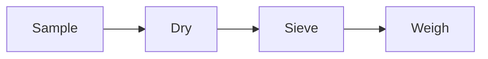

# Figures and tables

## Pictures

Click **Insert → Picture**, drag a picture onto the page, or paste one. Markooj copies the picture into an `assets` folder next to your document and writes a link to it:

```

```

If the document has not been saved yet, the picture is stored inside the document itself. Keep the `assets` folder with the document when you move or share it.

To give a picture a number and a caption, select it and click **References → Insert Caption** (Ctrl+Alt+Shift+C). It then shows as **Fig. 1.** with your caption, and you can refer to it anywhere. See [Numbering and cross-references](numbering-and-cross-references.md).

Pictures from the web (links starting with `http`) are not loaded unless you allow it in File → Options → Privacy. See [Privacy](privacy.md).

## Diagrams

**Insert → Diagram** draws a flowchart, sequence diagram, timeline or chart from a short text description, using Mermaid. For example:

````

````

The diagram follows the light or dark theme on screen and is always light in exports. Word, LaTeX and the other Pandoc formats get it as a picture.

## Tables

### Make a table

- **Insert → Table:** point to choose the number of columns and rows, then click. **Insert Table…** under the grid lets you type the numbers.
- **Convert Text to Table…** (also under Insert → Table) turns the selected lines into a table. Tabs, commas or semicolons mark the columns.

### Type in a table

Click into any cell and type. While you edit, dashed gridlines show every cell. They are never printed or exported; turn them off with **View → Gridlines**.

- **Tab** moves to the next cell, and **Shift+Tab** to the one before. Tab in the last cell adds a new row.
- **Enter** (or **Shift+Enter**) starts a new line inside the cell, as in Word. It is saved as `<br>` in the Markdown table.
- To leave the table, press **Down** in the last row, or click below it.
- A `|` you type in a cell is kept as text; it does not break the table.
- Right-click a cell for the table menu.

### Table Design and Table Layout

When the cursor is in a table, two extra tabs appear at the end of the ribbon:

**Table Design**
- **Header Row:** show the first row as a header. Markdown tables always have a header row, so when you turn it off, the row is left empty and hidden in Read mode, print and exports.
- **Table Styles:** Plain, Grid, Banded rows, Academic (three rules, as in research papers) or Accent (a colored header). The style applies to every table in the document. It shows on screen, in print, and in PDF and web page exports.
- **Convert to Text:** turn the table back into lines, with tabs, commas or paragraphs between the cells.

**Table Layout**
- **Select:** the row, the column or the whole table.
- **Rows & Columns:** Insert Above, Insert Below, Insert Left, Insert Right, and Delete (cells, row, column or table).
- **Distribute Columns:** give all columns the same width. Pandoc uses these widths for wide tables in Word and PDF exports.
- **Alignment:** align the column with the cursor left, center or right. Right is good for numbers.
- **Sort:** Ascending or Descending by the column with the cursor, or **Sort…** to pick a column. The header row stays on top.
- **Format Table:** line up the bars in the Markdown so it is easy to read. In Simple mode, Tab does this too.

### A caption for a table

Put the cursor in the table and click **References → Insert Caption**. Markooj writes a line such as `: Test runs {#tbl:runs}` next to the table, and the table shows as **Table 1.** Test runs.

### What a table looks like in the file

```
| Run | Flow (L/s) | Depth (cm) |
| :-- | ---------: | ---------: |
| A   |       12.5 |        4.1 |
| B   |       18.0 |        5.3 |

: Test runs {#tbl:runs}
```

Every change you make in the editor rewrites only that table, so the rest of your file stays exactly as it was. Tables are always written as standard pipe tables that GitHub, Pandoc and Obsidian read.
