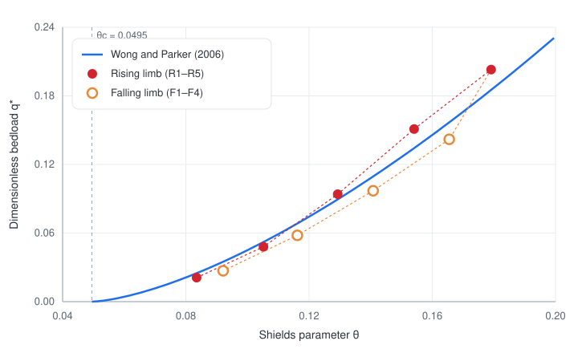

# Introduction {#sec:intro}

Gravel-bed rivers move most of their bed material during a few floods each year. Engineers usually predict that load with a steady-flow formula, even though the flow rises and falls within hours. This paper asks how large the error is when a steady formula is applied to an unsteady flood.

The threshold of motion goes back to @shields1936, and the classic bedload formula is that of @meyerpeter1948. @wong2006 reanalyzed the original data and found a smaller coefficient and exponent, which we use as the reference curve in @sec:methods.

> [!NOTE]
> All grain sizes in this paper are surface median diameters, $D_{50}$, measured with a sieve set at half-phi intervals.

# Methods {#sec:methods}

## Flume and sediment

The tests ran in a tilting flume 12 m long and 0.30 m wide. The bed was a 0.10 m layer of well-sorted gravel with $D_{50} = 4.5$ mm and a density of $\rho_s = 2650\ \text{kg/m}^3$. The diagram below shows the order of the work.

## Dimensionless parameters

The bed shear stress comes from depth and slope, and the Shields parameter scales it by the submerged weight of a grain:

$$
\theta = \frac{\tau_b}{(\rho_s - \rho)\, g\, D_{50}} = \frac{h\, S}{\Delta\, D_{50}}
$$ {#eq:shields}

where $\Delta = \rho_s/\rho - 1 = 1.65$. The measured transport rate per unit width, $q_b$, is made dimensionless with the Einstein number:

$$
q^* = \frac{q_b}{\sqrt{\Delta\, g\, D_{50}}\; D_{50}}
$$ {#eq:einstein}

The reference relation of @wong2006 is

$$
q^* = 3.97\,\left(\theta - \theta_c\right)^{3/2}, \qquad \theta_c = 0.0495
$$ {#eq:wongparker}

and the hysteresis index compares the rising and falling limbs at equal $\theta$:

$$
H_I = \frac{1}{N}\sum_{i=1}^{N} \frac{q^*_{\text{rise},i} - q^*_{\text{fall},i}}{q^*_{\text{rise},i}}
$$ {#eq:hysteresis}

# Results {#sec:results}

@tbl:runs lists the rising-limb runs. Every value of $\theta$ in the table follows from @eq:shields with the measured depth and slope.

| Run | Q (L/s) | h (m) | S | θ | q* measured | q* from @eq:wongparker |
|:----|--------:|------:|------:|------:|------:|------:|
| R1 | 18 | 0.062 | 0.010 | 0.084 | 0.021 | 0.025 |
| R2 | 24 | 0.071 | 0.011 | 0.105 | 0.048 | 0.052 |
| R3 | 31 | 0.080 | 0.012 | 0.129 | 0.094 | 0.089 |
| R4 | 38 | 0.088 | 0.013 | 0.154 | 0.151 | 0.134 |
| R5 | 45 | 0.095 | 0.014 | 0.179 | 0.203 | 0.185 |

: Rising-limb runs and the predicted transport {#tbl:runs}

@fig:loop plots both limbs against the reference curve. The falling-limb points sit below the rising-limb points at the same $\theta$, so the loop is clockwise. With @eq:hysteresis the index is $H_I = 0.31$.

{#fig:loop}

# Discussion {#sec:discussion}

The steady formula is close on the rising limb but over-predicts the falling limb by about a third.[^armor] A practical consequence is that annual loads computed from a rating curve will be too high in rivers where floods recede slowly. %%Check whether F2 had a blocked trap.%%

Future tests will vary the rate of rise, as suggested by @parker1990 for surface-based relations, and repeat the runs with a sand fraction of 15 percent.

[^armor]: A coarser surface layer formed during the peak and was still in place on the falling limb.

# References
